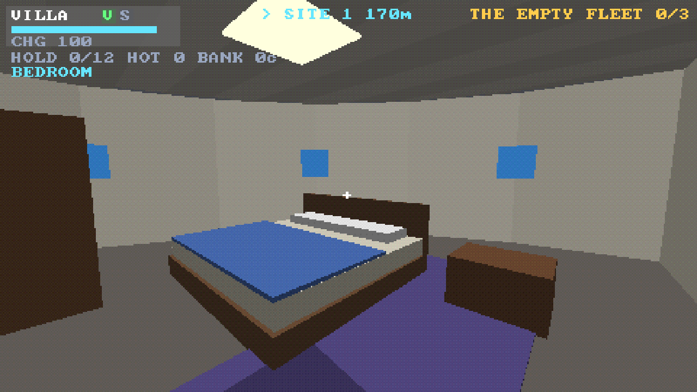
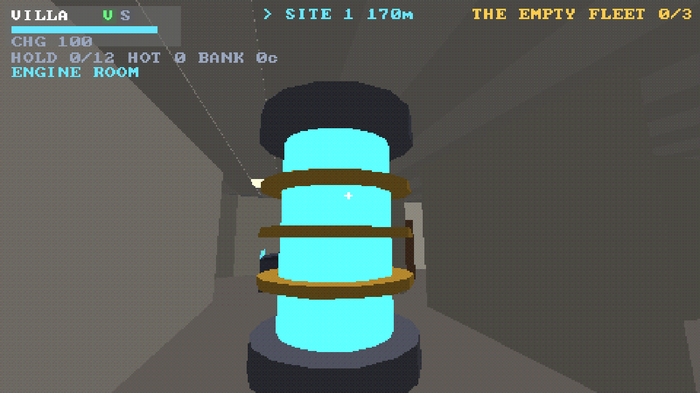

# Saucer

A first-person retro-3D exploration game. You are a person living inside a
flying saucer: at its biggest it is a glass dome you walk around in — an
open-plan kitchen, living room and helm under the glass, with a bedroom,
bathroom and engine room on the deck below. Walk to the helm, take the seat
and fly through a randomly generated universe to huge alien derelicts, so big
that the whole saucer flies inside their halls. Only for really tight ducts
does the saucer reconfigure around you, folding everything else away until
it is a one-seat car (the Seat), and unfold again once there is room. No
lethal weapons: the risk is losing the loot you haven't banked yet.

The vertical slice (concept v0.4, [`docs/concept.md`](docs/concept.md)): walk
the two decks, take the helm, fly the Villa into a derelict's great halls,
tractor loot through the glass, fold down to the Seat for a duct, come back
out, unfold, and leave the site to bank it. Keyboard/mouse, gamepad, touch
(mobile web) and basic WebXR are supported. The implementation plan is
[`docs/ROADMAP.md`](docs/ROADMAP.md).

| | |
|---|---|
|  |  |
|  |  |
|  | |

[Play in browser](https://makesgamessteve-hash.github.io/saucer/) — the live
web build on GitHub Pages, rebuilt on every push to `main`.

## Layout

| Path | What |
|---|---|
| `engine/src/core` | C11 engine core (no SDL): sim loop, Lua runtime + `saucer.*` API, VFS, mods, input, physics, mesh builder, serializer, replays |
| `engine/src/platform` | SDL3 window/input/audio, OpenGL 3.3 / WebGL2 renderer |
| `web/` | emscripten shell page and WebXR glue |
| `data/base/` | the base game, itself a mod: Lua scripts, data tables, mesh recipes, palettes, sprites, sounds |
| `mods/` | user mods (`mods/<id>/mod.lua`), created beside the binary |
| `tests/` | C unit tests, Lua specs, headless game tests, replays, fixtures |
| `tools/` | `artpipe` (asset pipeline + license lint), `coverage.sh` |
| `openspec/` | project conventions and changes 0–22 |

Assets are never baked into the binary: the build copies `data/` next to the
executable, and the web build fetches the files listed in `data/index.json`.

## Build

Requirements: CMake ≥ 3.20, a C11 compiler, Ninja (optional). SDL3 is used
from the system if found, otherwise fetched and built (`SAUCER_FETCH_SDL`).

```sh
# Linux
cmake -S . -B build -G Ninja -DCMAKE_BUILD_TYPE=Release
cmake --build build
./build/saucer                    # windowed game
./build/saucer_headless --help    # no window, no SDL

# Windows (MSVC)
cmake -S . -B build -G "Visual Studio 17 2022" -A x64
cmake --build build --config Release
build\Release\saucer.exe

# Web (emscripten); serve build/web over HTTP and open saucer.html
# A live build is also at https://makesgamessteve-hash.github.io/saucer/
emcmake cmake -S . -B build/web -G Ninja -DCMAKE_BUILD_TYPE=Release
cmake --build build/web
python3 -m http.server -d build/web 8000   # http://localhost:8000/saucer.html?seed=42
```

macOS is not a target for now.

## Controls

| | Keyboard / mouse | Gamepad | Touch | WebXR |
|---|---|---|---|---|
| Walk (on foot) / fly (at the helm) | W A S D | left stick | left stick | left stick (walks where you look) |
| Lift (at the helm) | Space / Ctrl | triggers | right slider | right stick |
| Turn / look | mouse (click to capture, Esc releases), arrows | right stick | drag right half | head, right stick |
| Use: take the helm / stand up | G / Return | X | Use button | left trigger |
| Fold to the Seat / unfold the Villa | Q / E, wheel, 1–2 | LB / RB | buttons | A / B, or grip + stick (size lever) |
| Tractor beam | F / left click | A | button | right trigger |
| Scan, run/boost, camera, help | V, Shift, C, H | Y, LS, Back, Start | buttons | X, left grip, —, menu |

You start on foot under the dome. Walk to the helm at the front and press Use
to fly; press Use again to stand up (the saucer holds station). Folding on
foot forms the Seat around wherever you stand and seats you in it.

Press A on a second gamepad (with `--coop`) to join as player 2; each player
lives in and flies their own saucer. `--local-players 2 --viewports 2` starts split screen.

## Useful options

```
--seed N  --root DIR  --user-dir DIR  --mods a,b  --mods-dir DIR
--local-players N  --viewports N  --coop
--record FILE.srep  --play FILE.srep  --restore-every-tick
--screenshot FILE.png --screenshot-tick N     (exits after the capture)
--headless --ticks N  --script tests/game/slice.lua  --test-lua tests/lua
```

## Tests

```sh
ctest --test-dir build --output-on-failure   # C unit, Lua specs, game tests, replays
tools/coverage.sh                            # coverage gate: >= 95% lines, C (gcovr) and Lua (luacov)
```

- **C unit tests** (`tests/c`): known-answer vectors for the RNG and the
  deterministic math (`tests/data/*_kat.txt`; regenerate with
  `SAUCER_WRITE_KAT=1`), VFS, serializer, replays, mods, renderer lists,
  input, touch, XR, engine lifecycle.
- **Lua specs** (`tests/lua/*_spec.lua`) for every base-game module.
- **Game tests** (`tests/game`): headless, seeded, scripted input
  (`saucer.test.press/axis/touch/xr/wait`). `slice.lua` plays the whole
  vertical slice (walk to the helm, fly into the halls, fold for a duct,
  unfold, bank, walk to the kitchen); `interior.lua` tours both decks on foot;
  `boot.lua` covers touch, XR and rendering; `coop.lua` runs two players;
  `mods.lua` loads the fixture mods.
- **Replays** (`tests/replays/*.srep`): recorded command frames with a state
  hash every 60 ticks; they must reproduce bit-for-bit on Linux, Windows and
  wasm. Re-record after an intended sim change with
  `saucer_headless --seed 42 --script tests/game/slice.lua --record tests/replays/slice_seed42.srep`.

CI (`.github/workflows/ci.yml`) runs linux-gcc with the coverage gate and an
Xvfb screenshot, linux-clang with ASan/UBSan, windows-msvc, emscripten
(tests under node plus the web build) and a lint job (OpenSpec validation,
asset licenses and prompt records). Pushing to `main` also builds the
emscripten web target and deploys it to
[GitHub Pages](https://makesgamessteve-hash.github.io/saucer/).

## Modding

Every mod is a folder with a `mod.lua` manifest (`id`, `version`, `api = 1`,
`depends`, `load_after`, `entry`, `license_code`, `license_assets`). Files in
later mods override files at the same path in earlier ones, scripts run in a
sandbox with an instruction budget, and `on_render` gets a read-only state.
See `tests/fixtures/mods/bigger_tractor` for a small example.

Notes for modders: index-map textures are 8-bit grayscale PNGs whose values
are palette indices (index 0 is transparent); palettes are PNG strips with
one row of 256 colours per palette. Library modules loaded with `require`
are shared between the sim and render hooks, so keep their module tables
free of mutable sim state.

## Art

Low-poly geometry built entirely by Lua mesh recipes (`data/base/meshes`),
palette-locked textures, sprites and a low-res target with nearest-neighbour
upscaling. Two textures were generated with Grok Imagine; every prompt is in
`art/prompts/log.jsonl`. `python3 tools/artpipe/artpipe.py build` rebuilds
the processed assets and `ATTRIBUTION.md`; `lint` checks licenses and prompts.

## License

Code: MIT. Hand-made and code-generated art and sound: CC BY 4.0. Images
generated with Grok Imagine: xAI output terms ("Created with Grok"). See
[LICENSING.md](LICENSING.md) and [ATTRIBUTION.md](ATTRIBUTION.md).
